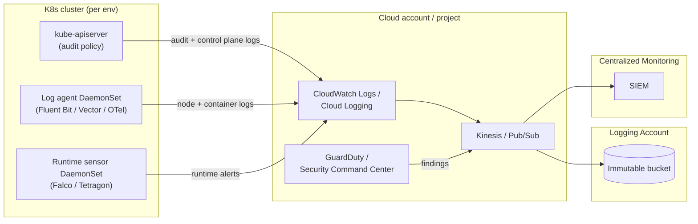

# Security Logging in Cloud Environments - Kubernetes

- [Problem Statement](https://blog.marcolancini.it/2026/blog-security-logging-cloud-environments-kubernetes#problem-statement)
- [Which Log Sources Can We Leverage?](https://blog.marcolancini.it/2026/blog-security-logging-cloud-environments-kubernetes#which-log-sources-can-we-leverage)
  - [Audit Logs](https://blog.marcolancini.it/2026/blog-security-logging-cloud-environments-kubernetes#audit-logs)
  - [Control Plane Logs](https://blog.marcolancini.it/2026/blog-security-logging-cloud-environments-kubernetes#control-plane-logs)
  - [Node and Container Logs](https://blog.marcolancini.it/2026/blog-security-logging-cloud-environments-kubernetes#node-and-container-logs)
  - [Runtime Events](https://blog.marcolancini.it/2026/blog-security-logging-cloud-environments-kubernetes#runtime-events)
  - [Network Flows](https://blog.marcolancini.it/2026/blog-security-logging-cloud-environments-kubernetes#network-flows)
  - [Kubernetes Events](https://blog.marcolancini.it/2026/blog-security-logging-cloud-environments-kubernetes#kubernetes-events)
  - [Managed Offerings: EKS vs GKE](https://blog.marcolancini.it/2026/blog-security-logging-cloud-environments-kubernetes#managed-offerings-eks-vs-gke)
  - [Blind Spots](https://blog.marcolancini.it/2026/blog-security-logging-cloud-environments-kubernetes#blind-spots)
- [State of the Art Security Logging Platform in Kubernetes](https://blog.marcolancini.it/2026/blog-security-logging-cloud-environments-kubernetes#state-of-the-art-security-logging-platform-in-kubernetes)
  - [Collection](https://blog.marcolancini.it/2026/blog-security-logging-cloud-environments-kubernetes#collection)
  - [Delivery, Long-Term Storage and Audit Trail](https://blog.marcolancini.it/2026/blog-security-logging-cloud-environments-kubernetes#delivery-long-term-storage-and-audit-trail)
  - [Monitoring and Alerting](https://blog.marcolancini.it/2026/blog-security-logging-cloud-environments-kubernetes#monitoring-and-alerting)
- [Conclusions](https://blog.marcolancini.it/2026/blog-security-logging-cloud-environments-kubernetes#conclusions)

If your workloads run on Kubernetes, where should your security logs come from?

This post, part of the “[Continuous Visibility into Ephemeral Cloud Environments](https://blog.marcolancini.it/continuous-cloud-visibility/)” series,
describes a design for a state of the art security logging platform for Kubernetes clusters.
It completes the set started by the [AWS](https://blog.marcolancini.it/2021/blog-security-logging-cloud-environments-aws) and
[GCP](https://blog.marcolancini.it/2021/blog-security-logging-cloud-environments-gcp) posts,
both of which promised “a follow-up post” on worker node and container logs.
This is that post, a few years later than planned.

# Problem Statement

The AWS and GCP posts covered the cloud control plane:
CloudTrail and Cloud Audit Logs tell you who created a cluster, changed a node group, or edited a firewall rule.

A Kubernetes cluster adds **a second control plane on top of the cloud one**,
with the cloud logs stopping at its edge.
CloudTrail will not tell you who ran `kubectl exec` into a production pod,
or which service account read every Secret in the `payments` namespace five minutes ago.

The end goal here is to deploy a security logging and monitoring solution with well established metrics and integrations with a SIEM of choice.
In particular, the solution should be able to:

- Collect security-related logs from every cluster, managed or self-managed.
- Ship them into the same pipeline that already handles your cloud logs.
- Keep them long enough, and tamper-proof enough, to support an investigation.
- Alert on anomalous behaviour.

In this regard, this post is composed of two main parts.
The first introduces the **log sources Kubernetes and the managed offerings make available**, while
the second describes the **high-level architecture and best practices** for a security logging platform built on them.

# Which Log Sources Can We Leverage?

A cluster produces security-relevant signal at several layers:
the API server, the control plane components, the nodes, the containers, and the network between them.
Graham Helton’s [A Guide To Kubernetes Logs That Isn’t A Vendor Pitch](https://grahamhelton.com/blog/kubenretes-auditpolicy.html)
walks through each layer, and it is the best single read on the topic I have found.

At a high level:

| Source | What it provides |
| --- | --- |
| *Audit logs* | Every request to the Kubernetes API: who, which verb, which resource, from which IP, and the response code. |
| *Control plane logs* | - API server, scheduler, controller manager and (on EKS) authenticator output. - The authenticator log maps cloud identities to Kubernetes users. |
| *Node and container logs* | Application `stdout`/`stderr`, kubelet and container runtime logs, node OS logs. |
| *Runtime events* | Process, file and network activity inside containers, seen by an eBPF sensor or a managed agent. |
| *Network flows* | VPC flow logs, plus CNI-level flow and network policy verdicts. |
| *Kubernetes Events* | Scheduling failures, image pulls, OOM kills, probe failures. |

## Audit Logs

The [audit log](https://kubernetes.io/docs/tasks/debug/debug-cluster/audit/) is the most valuable source in the cluster.
The `kube-apiserver` records an event for every request it handles,
at up to four **stages**: `RequestReceived`, `ResponseStarted` (only for long-running requests like `watch` or `exec`), `ResponseComplete`, and `Panic`.

An **audit policy** then decides, rule by rule, how much to record:

| Level | What gets recorded |
| --- | --- |
| `None` | Nothing. |
| `Metadata` | User, timestamp, resource, verb, source IP. No bodies. |
| `Request` | Metadata plus the request body. |
| `RequestResponse` | Metadata plus request and response bodies. |

The API server evaluates the rules in order and **the first match wins**,
then writes the event to a **backend**: a log file on the control plane node (`--audit-log-path`)
or an HTTP **webhook** (`--audit-webhook-config-file`).
Without `--audit-policy-file`, the API server logs nothing.

A few points worth highlighting:

- You should **log `Secrets`, `ConfigMaps` and `TokenReviews` at the `Metadata` level only**, otherwise if you use either `Request` or `RequestResponse` you’ll end up copying secret values into your logs.
- **On managed clusters you don’t own the audit policy.** EKS and GKE ship their own and expose no setting to change it: you only choose whether to collect the result. (Both log `Secrets`, `ConfigMaps` and `TokenReviews` at the `Metadata` level by the way.)
- On GKE, reads like `get` and `list` go to *Data Access* audit logs, which are off by default and billed once you turn them on. [Enable Data Access audit logs](https://padlock.argh.in/2022/02/10/gke-audit.html) for the Kubernetes Engine API, or an attacker can dump a `Secret` without leaving a line in your logs.

For more on what to look for in these events, see Datadog’s [Key Kubernetes audit logs for monitoring cluster security](https://www.datadoghq.com/blog/key-kubernetes-audit-logs-for-monitoring-cluster-security/)
and the [Kubernetes Audits Introduction](https://dev.bitolog.com/kubernetes-audits-introduction/).

## Control Plane Logs

Beyond the audit log, the control plane components write their own logs.
On self-managed clusters they run as static pods on the control plane nodes, and you collect them like any other container log.
Managed offerings expose them as opt-in streams:

- **EKS** [control plane logging](https://docs.aws.amazon.com/eks/latest/userguide/control-plane-logs.html) has five log types: `api`, `audit`, `authenticator`, `controllerManager` and `scheduler`. All are **off by default**, and you have to enable each type on its own to have EKS deliver them to CloudWatch Logs at standard CloudWatch prices. Delivery takes a few minutes, and AWS describes it as best effort. AWS has a good write-up on [what each type is worth and how to keep the bill down](https://aws.amazon.com/blogs/containers/understanding-and-cost-optimizing-amazon-eks-control-plane-logs/).
- **GKE** writes its audit logs to Cloud Logging as part of Cloud Audit Logs, and lets you opt into [API server, scheduler and controller manager logs](https://docs.cloud.google.com/kubernetes-engine/docs/concepts/about-logs) on top of the default system and workload logs.

## Node and Container Logs

**Containers** write to `stdout` and `stderr`.
The container runtime (containerd or CRI-O, since Kubernetes removed dockershim in 1.24)
stores that output in files under `/var/log/pods/` on the node.
The kubelet then rotates those files (by default at 10Mi, keeping 5 files per container),
and deletes them when the pod goes away.
So make sure to **treat the node as a short buffer**: if a pod gets evicted or the autoscaler removes a node, its logs go with it.

**System components** follow a different path.
On nodes with systemd, the kubelet and the container runtime run as services and write to `journald`.
Add the node OS logs you would collect from any VM (authentication, `sshd`, `auditd` if you run it), and you have the full picture of a node.

Kubernetes leaves **cluster-level** collection to you, and the official [Logging Architecture](https://kubernetes.io/docs/concepts/cluster-administration/logging/) docs describe two patterns:

| Pattern | Description |
| --- | --- |
| **Node agent (DaemonSet)** | - One agent per node (Fluent Bit, Vector, or the OpenTelemetry Collector) reads `/var/log/pods/` and `journald`, adds pod metadata (namespace, pod name, labels) from the API, and ships everything off the node. - This is the default choice: one deployment covers every workload, and apps keep logging to `stdout`. |
| **Sidecar container** | - A logging container in each pod tails files the application writes, for apps that can't log to `stdout`. - Native sidecar containers (an init container with `restartPolicy: Always`) start before and stop after the app container. |

For the managed offerings, there are some differences:

- **EKS** collects nothing from the nodes until you deploy an agent, for example Fluent Bit through the [Amazon CloudWatch Observability add-on](https://docs.aws.amazon.com/AmazonCloudWatch/latest/monitoring/install-CloudWatch-Observability-EKS-addon.html).
- **GKE** collects system and workload logs into Cloud Logging by default, through the GKE logging agent (a Google-managed Fluent Bit deployment on every node).

The CNCF’s [Kubernetes logging best practices](https://www.cncf.io/blog/2023/07/03/kubernetes-logging-best-practices/)
covers the application side (structured logs, log levels, and what not to log).

## Runtime Events

The limit of audit logs is that they only see the API.
If an attacker gets a shell through a bug in your application, nothing about it touches the API server:
the shell and the crypto miner it downloads both run inside the container.

**Runtime sensors** close that gap by watching system calls from the kernel, today almost always through eBPF.

| Option | Description |
| --- | --- |
| [Falco](https://cloudsecdocs.com/containers/defensive/tooling/falco/) | - CNCF graduated project that matches syscall events, collected by its modern eBPF driver, against rules. - Its `k8saudit` plugins also read audit logs: from the API server webhook, from CloudWatch Logs on EKS (`k8saudit-eks`), or from Pub/Sub on GKE (`k8saudit-gke`). - Pair it with `falcosidekick` to forward alerts. |
| [Tetragon](https://tetragon.io/) | - Cilium's eBPF-based security observability and runtime enforcement tool. - It filters events in the kernel, so you choose what to record with `TracingPolicy` resources instead of shipping every syscall. |
| [GuardDuty](https://cloudsecdocs.com/aws/services/security/guardduty/) (EKS) | - *Runtime Monitoring* runs a managed EKS add-on (`aws-guardduty-agent`) that watches process, file and network activity in containers. It does not support EKS on Fargate. - *EKS Protection* analyses the EKS audit logs through its own stream, so it works without control plane logging. - *Extended Threat Detection* correlates both into a single `AttackSequence:EKS/CompromisedCluster` finding. |
| [Security Command Center](https://cloudsecdocs.com/gcp/services/security/scc/) (GKE) | - *Container Threat Detection* (Premium tier) watches Container-Optimized OS nodes for binaries or libraries that were not in the original image, and for reverse shells. - *Event Threat Detection* reads the GKE audit logs. Some of its detectors need Data Access logs turned on. |

If you run on EKS or GKE, turn on the managed option first: it takes a toggle or an add-on install,
and the findings land where your other cloud findings already go.
Add Falco or Tetragon when you need rules for your own workloads.
Sysdig’s [comparison of GuardDuty and Falco on EKS](https://sysdig.com/blog/guardduty-falco-eks-detection/) is a fair look at the trade-off, even if it comes from Falco’s creators.

## Network Flows

VPC flow logs still work, and with VPC-native networking (the VPC CNI on EKS, VPC-native clusters on GKE) they record pod IPs.
Pod IPs change every time a pod restarts, though, so a flow log is only useful if you also recorded which pod held an IP at each time.

CNI-level logs add the Kubernetes context:
the [VPC CNI network policy agent](https://docs.aws.amazon.com/eks/latest/userguide/network-policies-troubleshooting.html) on EKS (off by default, turn on `enablePolicyEventLogs`) and [network policy logging](https://docs.cloud.google.com/kubernetes-engine/docs/how-to/network-policy-logging) on GKE (Dataplane V2 clusters only)
record allowed and denied connections against your NetworkPolicies,
and [Hubble’s flow log exporter](https://docs.cilium.io/en/stable/observability/hubble/configuration/export/) does the same for Cilium clusters.

## Kubernetes Events

Kubernetes Events (failed scheduling, image pull errors, OOM kills, failed mounts) are API objects,
and the API server **deletes them after one hour** by default (EKS now lets you shorten that window, not extend it).
You won’t write many detections on them, but during an incident they tell you what the cluster did around the time of the attack.
If you want them later, export them with an event exporter or your log agent.

## Managed Offerings: EKS vs GKE

Putting it together, this is what you get out of the box, and what you have to switch on:

| Log source | EKS | GKE | Self-managed |
| --- | --- | --- | --- |
| *Audit logs* | - `audit` control plane log type to CloudWatch Logs - Off by default - AWS-managed policy | - Admin Activity: always on - Data Access: off by default - Google-managed policy | - You write the policy and pick the backend |
| *Control plane logs* | - `api`, `authenticator`, `controllerManager`, `scheduler` - Off by default | - API server, scheduler, controller manager - Off by default | - Static pod logs on the control plane nodes |
| *Node and container logs* | - Your own agent, or the CloudWatch Observability add-on | - Collected by default | - Your own agent |
| *Network flows* | - VPC Flow Logs - VPC CNI network policy logs | - VPC Flow Logs - Dataplane V2 network policy logging | - Depends on the CNI (e.g., Hubble) |
| *Managed threat detection* | - GuardDuty EKS Protection (audit logs) - GuardDuty Runtime Monitoring | - SCC Event Threat Detection (audit logs) - SCC Container Threat Detection - Premium tier | - None |
| *Your own runtime sensor* | - Falco or Tetragon | - Falco or Tetragon | - Falco or Tetragon |

## Blind Spots

Even with all of the above switched on, a few things slip through:

- **What happens inside `kubectl exec`.** The audit log records the request on the `pods/exec` subresource, with the command in the `requestURI`. It does not record what the user typed once the shell opened: a runtime sensor does.
- **Direct calls to the kubelet API.** Requests that go straight to a kubelet on port `10250` never reach the API server. With webhook authorization, the most you see is the kubelet (`system:node:<name>`) creating a `SubjectAccessReview`, and the kubelet caches those decisions for minutes at a time.
- **Non-standard pods and containers.** The kubelet starts static pods from manifests on the node’s disk, and the API server only sees a read-only *mirror pod*. Wiz’s [post on Kubernetes API limitations](https://www.wiz.io/blog/kubernetes-api-limitations-in-finding-non-standard-pods-and-containers) covers static, mirror, init, pause and ephemeral containers, and how each one hides from tools that only ask the API.
- **Node access.** An SSH or SSM session on a node bypasses Kubernetes. You find it in CloudTrail (`StartSession`) or Cloud Audit Logs, plus the node’s own authentication logs.
- **The cloud side of the cluster.** Changes to the cluster itself (EKS access entries, node groups, GKE cluster settings) and the cloud API calls your pods make through IRSA, EKS Pod Identity or Workload Identity show up in CloudTrail and Cloud Audit Logs. The AWS and GCP posts already collect those: make sure you can join them with the Kubernetes logs on the identity.

### 📙 The CloudSec Engineer is out now!

*The CloudSec Engineer* is a practical guide on how to enter, establish yourself, and thrive in the Cloud Security industry as an individual contributor.
  
  
You can head over to [CloudSecBooks.com](https://cloudsecbooks.com) to find more information about the book and its contents.

# State of the Art Security Logging Platform in Kubernetes

I’ll assume the same setup as the AWS and GCP posts:
multiple projects (or customers), each with **production and non-production environments**,
and each environment running at least one Kubernetes cluster (EKS or GKE).
The Kubernetes layer adds three collectors to every cluster,
and then plugs into the pipeline those posts already built.

## Collection

From each cluster, the following information should be collected:

| Log Type | Description |
| --- | --- |
| **Audit Logs** | - **EKS**: enable the `audit` and `authenticator` control plane log types. - **GKE**: enable Data Access audit logs for the Kubernetes Engine API. - **Self-managed**: point the log backend at a file on the control plane node and let the node agent pick it up, or use the webhook backend to send events straight to your collector. You also have to write the audit policy. Start from these rules:   - Omit the `RequestReceived` stage: every request also produces a `ResponseComplete` event.   - `None` for health check endpoints and `kube-proxy` watches.   - `Metadata` for Secrets, ConfigMaps and TokenReviews.   - `Request` for `pods/exec`, `pods/attach`, `pods/portforward` and `pods/ephemeralcontainers`.   - `RequestResponse` for changes to RBAC resources.   - `Request` for `create`, `update` and `patch` on pods and on the controllers that create them (Deployments, DaemonSets, StatefulSets, Jobs, CronJobs).   - `Metadata` for everything else. |
| **Node and Container Logs** | - Run one log agent as a DaemonSet. It should read `/var/log/pods/` and the `kubelet` and container runtime units in `journald`, add pod metadata, and forward everything to CloudWatch Logs or Cloud Logging. - **EKS**: deploy Fluent Bit (through the CloudWatch Observability add-on or your own Helm chart). - **GKE**: the built-in agent already does this, so keep it. - Give the agent an on-disk buffer: when the autoscaler removes a node, anything still in memory is gone. |
| **Runtime Events** | - **EKS**: enable GuardDuty EKS Protection and Runtime Monitoring. - **GKE**: enable Security Command Center's Event Threat Detection and Container Threat Detection. - Add Falco or Tetragon where you need detections the managed service doesn't have, and forward their alerts with `falcosidekick` or the log agent. |
| **Network Policy Logs** | - Collect them if your CNI supports them (the VPC CNI on EKS, Dataplane V2 on GKE, Hubble on Cilium). |
| **Kubernetes Events** | - Export them with an event exporter or your log agent if you want them for incident timelines. |

## Delivery, Long-Term Storage and Audit Trail

From here on, nothing is specific to Kubernetes, and the design from the AWS and GCP posts applies:

- On AWS, CloudWatch Logs subscription filters feed a [Kinesis stream](https://blog.marcolancini.it/2021/blog-security-logging-cloud-environments-aws#delivery), which a Logstash agent drains into the [Logging Account](https://blog.marcolancini.it/2021/blog-security-logging-cloud-environments-aws#long-term-storage-and-audit-trail) and its S3 bucket with Object Lock.
- On GCP, a log sink exports to [Pub/Sub](https://blog.marcolancini.it/2021/blog-security-logging-cloud-environments-gcp#delivery), and the [Logging Project](https://blog.marcolancini.it/2021/blog-security-logging-cloud-environments-gcp#long-term-storage-and-audit-trail) stores the logs in a bucket with a locked retention policy.

One Kubernetes-specific warning: **volume**.
Audit logs from a busy cluster add up fast, and where you can cut them depends on the platform:

- On self-managed clusters, filter in the audit policy, where it costs nothing.
- On GKE, add exclusion filters to the `_Default` log sink: Cloud Logging drops excluded entries before it bills for ingestion.
- On EKS, nothing filters before CloudWatch ingestion, so your lever is which control plane log types you turn on.

## Monitoring and Alerting

The Centralized Monitoring Account from the previous posts pulls everything into the SIEM.
GuardDuty and Security Command Center findings travel the same way
(Security Hub and EventBridge on AWS, notification configs and Pub/Sub on GCP),
so a single team triages cloud and cluster alerts in one place.

For your own detections, start with the events that are cheap to write and hard to explain away:

- Successful requests from `system:anonymous`.
- New bindings to `cluster-admin` or other privileged ClusterRoles, and any privileged binding for a default service account.
- `pods/exec` or `pods/attach` requests (verb `get` or `create`), or ephemeral containers added (`patch` on `pods/ephemeralcontainers`), in production namespaces.
- Pods created with `privileged: true`, `hostPID`, `hostNetwork` or `hostPath` mounts.
- Pods running images from registries you don’t use.
- Reads of Secrets by identities with no history of reading them.
- Bursts of `403` responses for a single service account, a common sign of someone testing a stolen token.

Expel’s [Three Kubernetes events worth investigating](https://expel.com/blog/three-kubernetes-events-worth-investigating/) explains the first three in detail.
For going further, Square’s threat hunting series
([part 1](https://developer.squareup.com/blog/threat-hunting-with-kubernetes-audit-logs/), [part 2](https://developer.squareup.com/blog/threat-hunting-with-kubernetes-audit-logs-part-2/))
maps audit log queries to MITRE ATT&CK,
and NCC Group’s [Detection Engineering for Kubernetes clusters](https://www.nccgroup.com/research-blog/detection-engineering-for-kubernetes-clusters/)
builds detection rules around privilege escalation paths.

# Conclusions

In this blog post, part of the “[Continuous Visibility into Ephemeral Cloud Environments](https://blog.marcolancini.it/continuous-cloud-visibility/)” series,
I described a possible approach for designing a security logging platform for Kubernetes clusters,
and how it plugs into the [AWS](https://blog.marcolancini.it/2021/blog-security-logging-cloud-environments-aws) and
[GCP](https://blog.marcolancini.it/2021/blog-security-logging-cloud-environments-gcp) designs.

I hope you found this post valuable and interesting,
and I’m keen to get feedback on it!
If you find the information shared helpful, if something is missing,
or if you have ideas on improving it,
please let me know on
[🐣 Twitter](https://twitter.com/lancinimarco) or at
[📢 feedback.marcolancini.it](https://feedback.marcolancini.it).

Thank you! 🙇‍♂️
